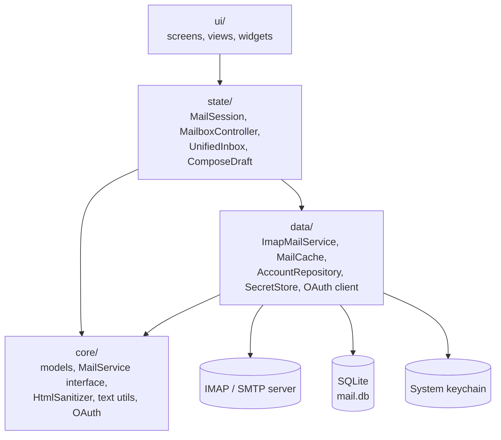
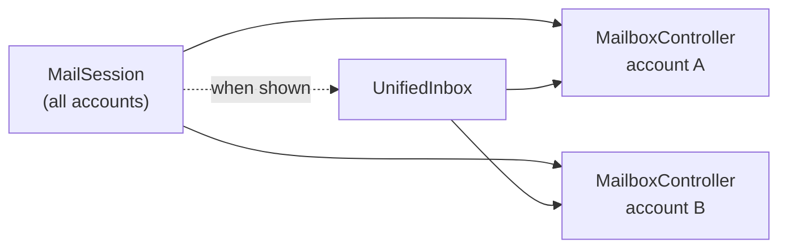
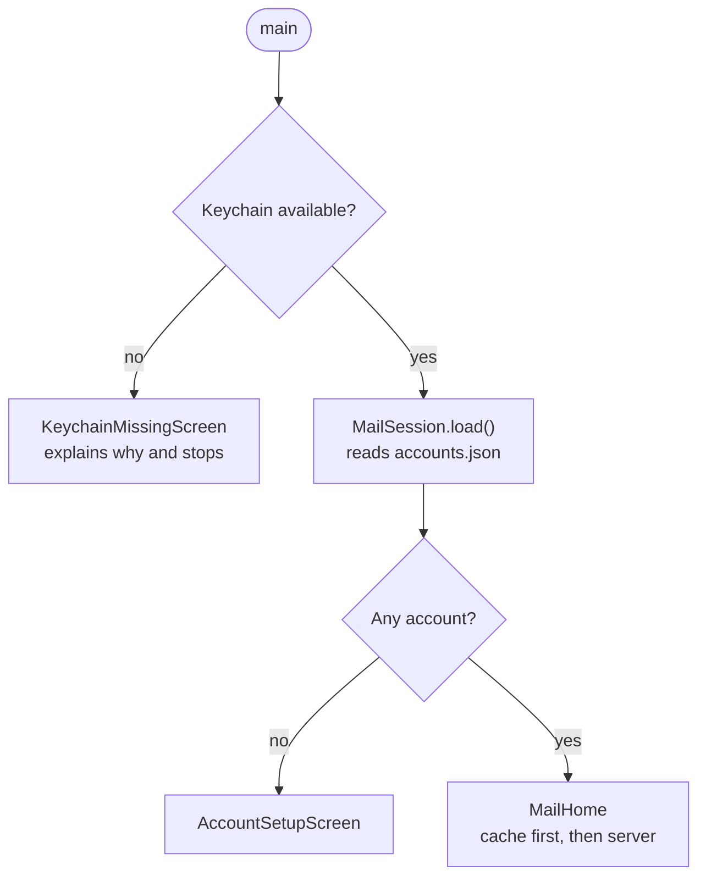

[Home](README.md) › Architecture

# Architecture

Kaamos Mail is split into four layers. Each layer only knows the ones below it.

| Layer | Folder | Role | Depends on Flutter? |
|---|---|---|---|
| core | `lib/src/core/` | Models (`Account`, `Folder`, `MessageSummary`…), the `MailService` interface, `HtmlSanitizer`, text helpers, OAuth provider config | No |
| data | `lib/src/data/` | Real implementations: IMAP/SMTP with `enough_mail`, SQLite cache, account file, keychain, OAuth sign-in | No (only plugins) |
| state | `lib/src/state/` | What the UI shows and the actions it can call, as `ChangeNotifier`s | Only `foundation` |
| ui | `lib/src/ui/` | Screens and widgets built with `kaamos_project_ui` | Yes |

The rule: **the UI never talks to IMAP or SQLite directly.** It reads fields of a controller and calls its methods.

## The `MailService` interface

`core/mail_service.dart` lists everything the app asks of a mail server: list folders, list UIDs, fetch summaries and flags, fetch a message, move, append, send…

The state layer only sees this interface. Two consequences:

- Tests replace it with `FakeMailService`, an in-memory server (see [Testing](testing.md)).
- One day JMAP can sit underneath without touching the controllers.

`MailServiceFactory` creates a connected `MailService` for an account and runs the "test connection" check of the add-account screen.

`ImapMailService` uses the low-level IMAP client of `enough_mail`, not its high-level `MailClient`, because the cache needs control over UIDs and `UIDVALIDITY`. IMAP is stateful (the selected folder), so every operation goes through a serial queue: two interleaved commands can never read the wrong folder. A dropped connection is retried once, which is common on mobile when the app comes back to the foreground.

## Dependency injection: `MailEnvironment`

`main.dart` builds the real services and passes them to `KaamosMailApp`, which puts them in `MailEnvironment`, an `InheritedWidget`:

| Field | Real implementation | In tests |
|---|---|---|
| `accounts` | `AccountRepository` (JSON file + keychain) | temp file + `MemorySecretStore` |
| `secrets` | `SystemSecretStore` (`flutter_secure_storage`) | `MemorySecretStore` |
| `cache` | `MailCache.open('mail.db')` | in-memory SQLite |
| `services` | `ImapMailServiceFactory` | fake factory |
| `files` | `PlatformFileActions` (file picker, open file, open link) | fake |
| `htmlBody` | `SafeHtmlWebView` (or text on Linux) | plain widget |
| `oauth` | loopback sign-in on desktop, `null` on mobile | fake / `null` |

Widgets get them with `MailEnvironment.of(context)`. No globals, so a test can build the whole app with fakes.

## State

- **`MailSession`** holds the account list and which account is shown. It creates one `MailboxController` per account the first time you open it and keeps it alive, so switching back is instant. A controller opens its IMAP connection only when needed.
- **`MailboxController`** is the state of one account: folders, the open folder's list, search, open message, errors. Its actions are **optimistic**: star and read change on screen immediately and roll back if the server refuses ("the interface must not lie").
- **`UnifiedInbox`** merges every account's Inbox: see [Unified Inbox](unified-inbox.md).
- **`ComposeDraft`** is pure logic for new / reply / reply all / forward: see [Compose and send](compose-and-send.md).

The UI listens with `ListenableBuilder`. There is no state management library: see [Decisions](decisions.md#state-changenotifier-no-library).

## Startup

See [Accounts and secrets](accounts-and-security.md) for the keychain check and [Sync and cache](sync-and-cache.md) for what "cache first" means.

## UI layout

`MailHome` has two layouts, switched at `desktopBreakpoint` (900 px):

- **Desktop**: three columns (folders, list, reader). Compose takes the place of the reader in the side pane instead of a popup.
- **Mobile**: pages stacked with a `Navigator` (list → message → compose).

Every widget comes from `kaamos_project_ui`, the Kaamos design system, pinned as a git dependency in `pubspec.yaml`.

## See also

- [Sync and cache](sync-and-cache.md)
- [Testing](testing.md)
- [Decisions](decisions.md)
