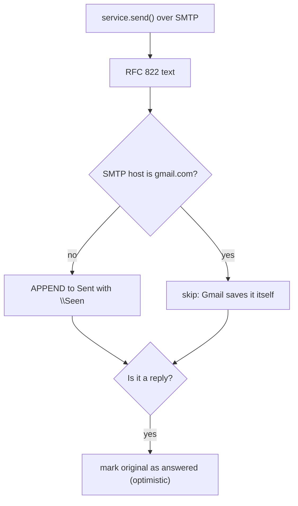

[Home](README.md) › Compose and send

# Compose and send

## Starting a message: `ComposeDraft`

`state/compose_draft.dart` is pure logic (no widgets), so the reply rules can be tested in `test/compose_draft_test.dart`.

| Kind | To | Cc | Subject | Body |
|---|---|---|---|---|
| New | empty | empty | empty | empty |
| Reply | `Reply-To` if present, otherwise the sender | empty | `Re: …` | quoted original |
| Reply all | as Reply | every other recipient of the original, without duplicates and **without yourself** | `Re: …` | quoted original |
| Forward | empty | empty | `Fwd: …` | forwarded original |

If you reply to a message you wrote yourself (for example from Sent), replying to yourself makes no sense, so your own address is dropped unless the list would end up empty.

Replies carry `In-Reply-To` and `References` (the conversation's `Message-ID` chain), so other clients thread them correctly.

## Writing

- **Plain text only.** HTML compose may come much later.
- On **desktop** the compose view is a **window at the bottom right**, over the three columns, like Gmail's (`ComposeWindowControls`). It floats 16px from the corner, 560px wide and a bit less than half the window tall (`composeWindowHeight`: 45%, between 360 and 720px, never more than the window minus the margins); when it is short, the fields and the text scroll together. Its title is the subject once there is one. It can be minimized to its title bar (the text stays: it lives in `ComposeViewState`, not in the fields), expanded to a large window, and closed. There is **one window at a time** (Alessio's choice, November 2026): "Scrivi" again brings back the open one, while a reply or forward first asks the open message to close (`requestClose`, which shows "Salvare la bozza?" if something is written; "Continua a scrivere" cancels the new one). Opening other messages leaves the window open.
- On **mobile** it is a new page, opened from the floating "Scrivi" button (`KaamosFab`), whose label hides while the list scrolls down.
- The text area is `MailTextArea` (`ui/widgets/text_area.dart`), a local widget until a `KaamosTextArea` exists in `kaamos_project_ui`.
- Attachments are picked with `file_picker` through `FileActions`.

## Sending: `MailboxController.send`

- If the copy in Sent fails, the mail **was** sent: the error says so explicitly.
- **Bcc never goes in the headers.** It is only added to the SMTP recipient list, otherwise every recipient would see the hidden addresses.
- When replying from the [Unified Inbox](unified-inbox.md), `answeredPath` points to the original's folder, which may not be the folder the account is showing.

## Drafts

`saveDraft` renders the message without sending it (`service.render`) and appends it to the Drafts folder with `\Draft` and `\Seen`. If the account has no Drafts folder it returns `false` and the UI says so.

## See also

- [Architecture](architecture.md#state)
- [Accounts and secrets](accounts-and-security.md)
