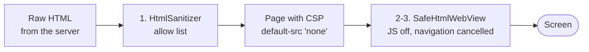

[Home](README.md) › Reading HTML mail

# Reading HTML mail

An HTML mail is a web page written by a stranger. It can track you (remote images that report when you opened it), run scripts, or try to look like something else. Kaamos Mail shows it behind **three walls, one inside the other**.



## 1. The sanitizer (`core/html_sanitizer.dart`)

It works as an **allow list**: it keeps only known tags and attributes, everything else goes. A deny list ("remove script and iframe") always forgets something.

- `script`, `iframe`, `form`, `svg` and similar are removed **with their content**.
- Unknown tags (such as Outlook's `<o:p>`) are unwrapped: the content stays, the tag goes.
- Comments are removed: Outlook conditional comments can contain HTML.
- Attributes: `on*` handlers, `javascript:` URLs, CSS `expression()` and `@import` are removed.
- `<style>` from `<head>` is moved into the body (newsletters need it), and the original `<body>` attributes (background, text colour) are kept, otherwise you get white text on white.
- `cid:` images become `data:` URLs from the message's inline parts.
- Remote images and backgrounds are counted (`blockedRemote`). If there is at least one, the UI shows **"Load images"**.
- Mail is always shown on a **light background**: `prefers-color-scheme: dark` rules are disabled, because they expect the client to darken the background.

The result is a full page with this Content-Security-Policy:

```
default-src 'none'; img-src data:; style-src 'unsafe-inline'; font-src data:
```

After "Load images", `img-src` and `font-src` also allow `https:` (and `http:` for images). `referrer` is set to `no-referrer`.

## 2. JavaScript off

`SafeHtmlWebView` (`ui/platform.dart`) wraps `flutter_inappwebview` with JavaScript disabled, incognito mode, no cache, no third-party cookies and no file access. On Android `blockNetworkLoads` is on too.

## 3. No network, no navigation

Every navigation except the initial `about:`/`data:` load is **cancelled**. `http`, `https` and `mailto` links are opened in the system browser instead. The WebView is keyed on the document, so "Load images" recreates it rather than reusing the old page.

## Linux

`flutter_inappwebview` does not support Linux. There, `UnsupportedHtmlBody` shows the text extracted from the HTML with a line explaining why the layout is missing. A Linux WebView is planned for phase 2.

Tests for the sanitizer are in `test/html_sanitizer_test.dart`.

## See also

- [Accounts and secrets](accounts-and-security.md#other-privacy-measures)
- [Platforms](platforms.md)
- [Decisions](decisions.md#html-mail-system-webview-locked-down)
