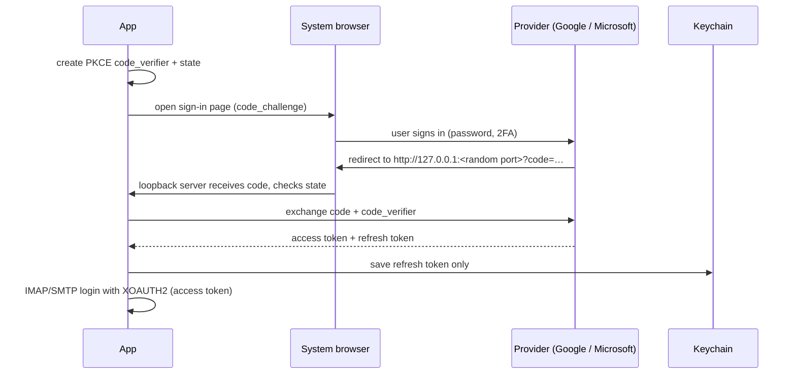

[Home](README.md) › Google and Microsoft sign-in

# Google and Microsoft sign-in (OAuth2)

Kaamos Mail uses IMAP and SMTP for Gmail and Outlook too, like Thunderbird and Apple Mail. Instead of the password it sends an *access token* with the XOAUTH2 mechanism. No Gmail API, no Microsoft Graph, so the rest of the app does not change.

## How it works



1. "Sign in with Google" opens the **system browser** on the provider's page. The app never sees your password or second factor.
2. The app listens on `127.0.0.1` (or `localhost`) on a random port. The browser comes back there with a code (RFC 8252, "loopback redirect").
3. The app exchanges the code for tokens using PKCE (RFC 7636): only whoever started the sign-in knows the `code_verifier`, so a stolen code is useless.
4. Only the **refresh token** goes in the keychain. The access token lasts about an hour and stays in memory; when it expires the app asks for a new one. One refresh serves concurrent IMAP and SMTP logins. If Microsoft sends a new refresh token, it replaces the old one.

For now this works on Windows, macOS and Linux. iOS and Android need a redirect with an app URL scheme: that comes in a later step.

### Code map

| File | Role |
|---|---|
| `core/oauth.dart` | Provider config (endpoints, scopes, client IDs from `--dart-define`), PKCE helpers, token parsing |
| `data/oauth_client.dart` | The loopback sign-in flow and token refresh |
| `data/imap_mail_service.dart` | `ImapMailServiceFactory` builds the XOAUTH2 login and saves rotated refresh tokens |
| `ui/platform.dart` | `platformOAuthSignIn()`: available on desktop, `null` on mobile |

## Registering the app

Client IDs are not secrets, but every build needs one. Pass them with `--dart-define`:

```sh
flutter run -d windows \
  --dart-define=KAAMOS_GOOGLE_CLIENT_ID=xxxx.apps.googleusercontent.com \
  --dart-define=KAAMOS_GOOGLE_CLIENT_SECRET=GOCSPX-xxxx \
  --dart-define=KAAMOS_MICROSOFT_CLIENT_ID=00000000-0000-0000-0000-000000000000
```

Without them the buttons stay disabled and the screen says which one is missing. A fork can use its own IDs without touching the code.

### Google

1. In the [Google Cloud Console](https://console.cloud.google.com/) create a project.
2. In "Google Auth Platform" configure the consent screen: type **External**, app name, support email.
3. In "Data access" add the scope `https://mail.google.com/`. It is a *restricted* scope.
4. In "Audience" leave the app in **Testing** and add the test users (at most 100).
5. In "Clients" create a client of type **Desktop app**. You get a client ID and a client secret. For desktop clients Google says the secret is not confidential, but its token endpoint still requires it.

Good to know:

- While the app is in Testing, Google expires refresh tokens after 7 days. Then you have to remove and add the account again.
- Leaving Testing with a restricted scope requires Google's verification, with a paid yearly security assessment.

### Microsoft

1. In [Microsoft Entra](https://entra.microsoft.com/) go to "App registrations" and choose "New registration".
2. In "Supported account types" choose accounts in any organization and **personal Microsoft accounts**.
3. As redirect URI choose the platform **Public client/native (mobile & desktop)** with value `http://localhost`. Microsoft ignores the port for loopback addresses.
4. In "API permissions" add the delegated permissions:
   - `IMAP.AccessAsUser.All` and `SMTP.Send` from Office 365 Exchange Online (`https://outlook.office.com`);
   - `offline_access`, `openid`, `email` and `profile`.
5. The client ID is the "Application (client) ID". No secret is needed.

Good to know: on work accounts the administrator may have turned off IMAP or SMTP AUTH. In that case sign-in succeeds but the server check fails.

## See also

- [Accounts and secrets](accounts-and-security.md)
- [Decisions](decisions.md#gmail-and-outlook-over-imap--oauth2)
