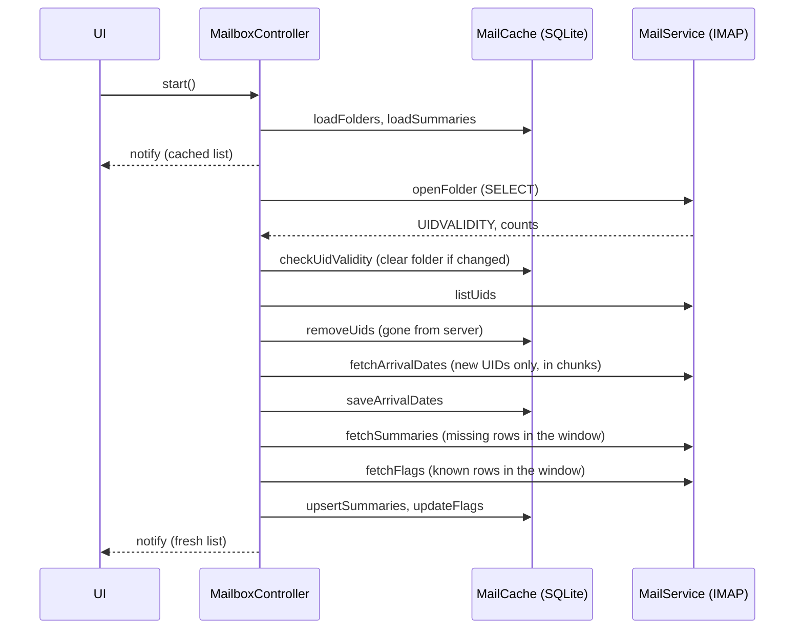

[Home](README.md) › Sync and cache

# Sync and cache

The goal: **open the app and see the list right away**, then ask the server in the background what changed. The server is the source of truth; when cache and server disagree, the server wins.

## Refreshing a folder ("option A")

`MailboxController.refresh()` and its private `_syncFolder()`:

Step by step:

1. **Cache first.** Show what SQLite has.
2. **`UIDVALIDITY`.** If the server's value changed, the cached UIDs point to other messages (or none), so the folder's cache is cleared.
3. **Gone messages.** UIDs in the cache but not on the server were deleted or moved by another client: they are removed.
4. **Arrival dates.** For UIDs never seen before, fetch `INTERNALDATE` in chunks (about 100 KB per command). The first time that is every message of the folder; afterwards only new ones.
5. **The visible window.** Take the newest N messages by arrival date. Download summaries only for the ones missing from the cache, and only flags (cheap) for the ones already there.
6. **Re-read the cache** and notify the UI.

"Load more" grows the window by one page (`pageSize`, 50) and repeats step 5.

## Why sort by arrival date and not by UID?

UIDs grow as messages **arrive in a folder**, so an old mail you just moved into the Inbox gets the highest UID. Sorting by UID would put it on top.

`INTERNALDATE` is the date the server received the message, and it does not change when the message moves. The IMAP `SORT` extension would do this on the server, but Gmail does not support it. So the app keeps its own lightweight index (`arrival_dates`) of **every** UID in the folder, even messages never shown, and sorts locally. On a tie the higher UID wins.

## Schema (version 2)

`data/mail_cache.dart`. Every table is keyed by `account_id`, so one database serves every account.

| Table | Key | Content |
|---|---|---|
| `folders` | `account_id, path` | name, role (inbox, sent, drafts…), `uid_validity` |
| `messages` | `account_id, path, uid` | sender, recipients (JSON), subject, date, preview, flags, has attachments |
| `arrival_dates` | `account_id, path, uid` | `arrival_ms`, with index `arrival_order` |

Notes:

- `STRICT` tables and `WITHOUT ROWID` for the composite keys; WAL journal mode.
- **No migrations.** It is a cache: when `PRAGMA user_version` is older than the code, the tables are dropped and everything is downloaded again. Simpler and risk-free.
- **Message bodies are not stored** yet. They are downloaded when you open a message. Full offline reading and local search are phase 2.
- Queries run synchronously on the UI thread. With 50-row pages they cost fractions of a millisecond. If they get heavy (full-text search) they move to an isolate.

## Previews

The list shows a one-line preview. `ImapMailService` fetches only the first bytes of each message's text part (two round trips, much lighter than whole messages). The cut can split a base64 or quoted-printable sequence, so the half sequence is trimmed before decoding.

## Optimistic actions

Star, read/unread, move, archive and delete update the list and the cache first, then call the server. If the server fails, the rows go back where they were and the error is shown.

## See also

- [Architecture](architecture.md)
- [Unified Inbox](unified-inbox.md)
- [Decisions](decisions.md#cache-sqlite-shown-first)
