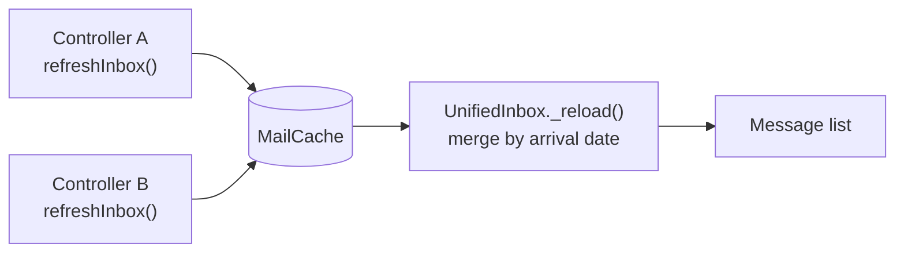

[Home](README.md) › Unified Inbox

# Unified Inbox

"Tutte le caselle" (all inboxes) shows every account's Inbox in a single list, newest first. It is offered only when there are at least two accounts: with one it would equal its Inbox.

## How it works

`state/unified_inbox.dart`:

- It **has no copy of its own** of the messages. It reads each Inbox from the shared SQLite cache and re-reads them every time an account's controller changes (sync, star, archive…).
- Each account contributes at most `pageSize` (50) messages, sorted by arrival date with `MailCache.loadSorted`. The merged list keeps the first 50: they must all be among those candidates.
- Ties are broken by account id, then by UID, so the order is stable.
- `refresh()` refreshes every account's Inbox **in parallel**. `MailboxController.refreshInbox()` syncs the Inbox without changing the folder the account is showing.

## Actions

Every action (star, read, archive, reply…) is done **by the controller of the message's account**, on its Inbox, even if that account is showing another folder. That is why `UnifiedItem` carries its controller and why the reader in `MailHome` switches controller when you open a message from another account.

Errors are prefixed with the account address, so you can tell which account is not answering.

## Limits (for now)

- No search and no "Load more" in this view: it shows the latest 50 messages.

## See also

- [Sync and cache](sync-and-cache.md)
- [Architecture](architecture.md#state)
